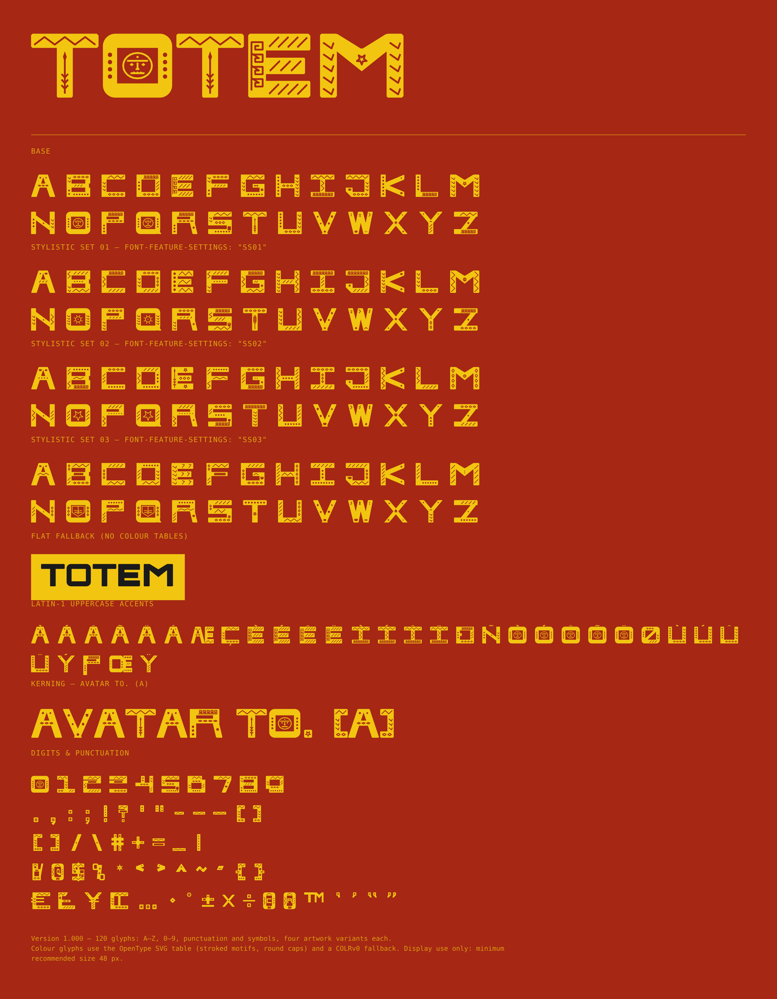

# Tribal Totem Display

Heavy blocky slab-sans display face with illustrated negative-space line art,
built as an **OpenType colour font**. Purpose: to create a new font.

> **Status: 1.000 release.** 120 mapped characters: `A–Z`, `0–9`, core
> punctuation and symbols, Latin-1 uppercase accents, currency and typographic
> marks. Four artwork variants per glyph, a curated kerning feature, and a
> commercial licence. Lowercase input maps to the capital glyphs.



## Quick start

```bash
pip install fonttools brotli skia-pathops uharfbuzz opentype-sanitizer
python3 build/build_font.py          # rebuilds glyphs/, dist/, specimen.html + .png
python3 build/verify.py              # 630 internal assertions
python3 build/shaping_test.py        # HarfBuzz GSUB/GPOS checks
python3 build/browser_test.py        # Chromium / Firefox / WebKit smoke test
python3 build/package_release.py     # release/ directory + zip + checksums
```

`build/build_font.py` is the single reproducible entry point: it regenerates
every SVG script and the font files from the parametric sources.

## Character set

| Group | Characters | Advance |
|---|---|---|
| Letters | `A–Z` | 800–860, except `M` at 1000 |
| Digits | `0–9` | 820 (tabular) |
| Latin-1 uppercase | `À Á Â Ã Ä Å Æ Ç È É Ê Ë Ì Í Î Ï Ð Ñ Ò Ó Ô Õ Ö Ø Ù Ú Û Ü Ý Þ Ÿ Œ` | as base letter |
| Punctuation / symbols | `. , : ; ! ? ' " - – — ( ) [ ] / \ # + = _ \| & @ $ % * < > ^ ~ \` { }` | 400–560 |
| Currency | `€ £ ¥ ¢` | 800–860 |
| Typographic marks | `… • ° ± × ÷ © ® ™ ‘ ’ “ ”` | 300–1000 |
| Space | `space`, `nbsp` | 300, no outline |

All 26 lowercase letters plus lowercase accented forms are mapped to their
capital glyphs, so ordinary mixed-case input renders as an all-caps line.
Digits and punctuation use real PostScript glyph names (`zero`, `period`,
`quotedbl`, `ampersand`, …) because CFF names cannot start with a digit or dot.

## Colour architecture

Each glyph exists in three representations generated from **one geometry
source**:

| Layer | Purpose |
|---|---|
| CFF outline | Flat fallback for apps without colour support |
| `SVG ` table | Full artwork: stroked motifs, width 20, round caps/joins |
| `COLR` v0 + `CPAL` | Two-layer colour fallback: body `#F2C511`, art `#A52714` |

Colours are exact: `#F2C511` (mustard) and `#A52714` (deep red). No gradients,
filters, masks or opacity are used — `verify.py` fails the build if any appear.

The colour build contains 476 colour glyphs (119 designed characters × 4
variants) plus CFF art layers. Characters with accents are composed from the
base letter and an accent contour, and inherit the base letter's artwork
variants.

**Why COLRv0 and not COLRv1:** the artwork is flat two-colour line art. COLRv1
adds gradients/transforms that this design does not use, at the cost of
compatibility. COLRv0 covers Chrome, Edge, Firefox, Windows 10+, recent Adobe
apps and Android.

## Construction

`T O E M` keep their original hand-picked artwork. Other letters, digits and
symbols are built from chamfered blocks (or stroked bands and polygons) that
are boolean-merged into clean outlines. Bodies with multiple holes
(B, D, P, R, 8, %, @, ©, ®) rely on containment-based winding in
`geom.Path.orient()`.

Artwork is assigned by a documented rotation: the motif library is cycled once
per variant, with a different start per zone. Horizontal bands cycle zigzag →
Greek key → diamonds → hatch → dots; vertical stems cycle dots → chevrons →
zigzag → hatch → diamonds; small square pockets use compact emblems (star, sun,
shield, mask); larger panels also draw on the figurative motifs (drum,
maraca). This guarantees every character has four different artworks.

Accented glyphs reuse the base letter's zones and artwork; only the accent
contour is added above the cap or below the baseline. The `.notdef` is a
chamfered hollow box in the same style.

## Stylistic sets and kerning

| Set | Effect |
|---|---|
| default | Each character's primary motif |
| `ss01` | Alternate illustration set 1 |
| `ss02` | Alternate illustration set 2 |
| `ss03` | Alternate illustration set 3 |

Stylistic sets swap **artwork only** and carry name-table descriptions for
InDesign/Illustrator menus. `verify.py` asserts the letter outline is
byte-identical across all four variants.

A `kern` feature (GPOS) tightens the obvious display pairs: diagonal capitals
(`A V W Y`) against each other and against `T L P F`, letters before and after
period/comma, quotes against letters, and brackets against letters. Figures are
tabular-safe: no kerning pairs involve tabular numerals.

```css
.tribal { font-family: "Tribal Totem Display"; font-feature-settings: "ss01"; }
```

## Metrics

| Property | Value |
|---|---|
| Units per em | 1000 |
| Cap height | 720 (letters and digits fill 0 → 720) |
| Accents / descenders | accents to 800; cedilla and thorn to −120 |
| Ascender / descender | 800 / −200 |
| Advances | letters 800–860 (M 1000); digits 820; punctuation 400–560 |
| Side bearings | 0 left for letters; punctuation is centred where practical |
| Art stroke | 20 units (renders as 4–6 px at 140–200 px cap height) |
| Art safety margin | ≥ 25 units of yellow from any outline (verified) |
| Weight class | 900 (Black), single-weight family |

## Quality checks

| Check | Result |
|---|---|
| Internal verification | 630/630 assertions pass |
| HarfBuzz shaping | 5/5: GSUB sets, kerning, extended chars |
| FontBakery universal profile | 0 FAIL, 0 WARN |
| OTS sanitizer | OTF, flat OTF and WOFF2 all pass |
| Browser rendering | Chromium, Firefox and WebKit all render colour |
| WOFF2 web build | loads and renders in Chromium |

Browser screenshots: `browser-chromium.png`, `browser-firefox.png`,
`browser-webkit.png`, `browser-woff2.png`.

## Rendering support

| Environment | Result |
|---|---|
| Chrome / Edge / Firefox / Safari | Full colour (SVG table) |
| Recent Illustrator / Photoshop | Colour via SVG table (untested here) |
| Word / PowerPoint / older apps | Flat one-colour glyphs |

No Adobe application is available in this build environment, so the
Illustrator/Photoshop path remains **untested** — use `specimen.html` to
confirm locally.

## Licence

Commercial font licence. See `LICENSE-EULA.txt`. The licence is embedded in
the font's `name` table. All artwork is original and generated from the
parametric motif library in `build/motifs.py`; nothing is traced from or
derived from an existing font.

The licence text is a working commercial template: have it reviewed by a
qualified lawyer in your jurisdiction before selling, and insert your support
contact details in the release materials.

## Roadmap

- [x] M1 — proof of concept: `T O E M`, colour pipeline, verification
- [x] M2 — `A–Z` base artwork, four variants per letter
- [x] M3 — digits, punctuation, `.notdef` house style
- [x] M4 — remaining ASCII symbols, uppercase accents, currency, typographic marks, kerning
- [x] M5 — commercial licence, Black naming, release packaging

## Known issues

- This is an all-caps face by design; lowercase input is mapped to capitals.
  There is no true lowercase design.
- Latin coverage is uppercase Latin-1 plus `Œ`, `Ÿ`; other extended-Latin
  characters are not built.
- The ampersand is an abstract display form; it is recognisable in context but
  is not a conventional traced `&`.
- Accent marks are simple geometric forms; they are not optically adjusted per
  letter beyond centring.
- The euro and pound forms are blocky display interpretations.
- Kerning is a curated display set, not an exhaustive pair matrix.
- Art on diagonal characters is deliberately compact.
- Adobe-app rendering is untested in this environment.
